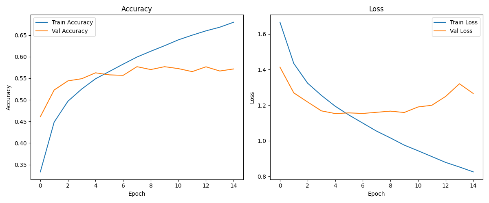
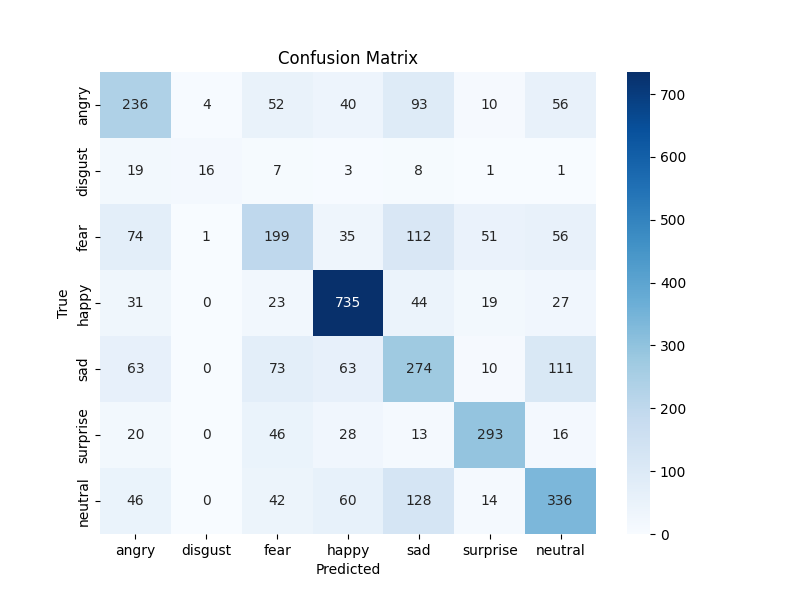

# Laboratory Report: Facial Emotion Recognition Using CNN (FER2013)

## 1. Introduction

Facial emotion recognition is a fundamental task in computer vision, with applications in human-computer interaction, security, healthcare, and marketing. This project explores the use of a convolutional neural network (CNN) trained on the FER2013 dataset to classify seven basic emotions: angry, disgust, fear, happy, sad, surprise, and neutral.

---

## 2. Data Preparation

- **Dataset:** FER2013 (Kaggle, 35,000+ grayscale images, 48x48 pixels)
- **Preprocessing:**
  - Images extracted and split into training, validation, and test sets by emotion class.
  - Resized to 64x64 pixels for improved feature extraction.
  - Pixel values normalized to [0, 1].
  - Median filtering applied for noise reduction.
  - Data augmentation (rotation, shift, zoom, horizontal flip) used for training set to improve robustness.

---

## 3. Model Architecture

- **Framework:** TensorFlow/Keras
- **Architecture:** Sequential CNN
  - Three convolutional layers (32, 64, 128 filters)
  - MaxPooling after each convolutional layer
  - Flatten layer followed by Dense (128 units, ReLU)
  - Dropout (0.5) for regularization
  - Output layer: Dense (7 units, softmax activation)

---

## 4. Training Procedure

- **Epochs:** 15
- **Batch size:** 64
- **Optimizer:** Adam
- **Loss function:** Sparse categorical crossentropy
- **Metrics:** Accuracy

---

## 5. Results

### 5.1 Training History

- Training accuracy steadily increases, reaching ~0.68.
- Validation accuracy plateaus at ~0.57–0.58, indicating possible overfitting after 7–8 epochs.
- Training loss decreases, while validation loss stabilizes and slightly increases after epoch 8.

---

### 5.2 Confusion Matrix

- "Happy" is recognized best (735 correct predictions).
- "Sad" and "neutral" are frequently confused.
- "Disgust" and "fear" are recognized worst, likely due to few samples and similarity to other emotions.

---
### 5.3 Classification Report

The classification report summarizes the precision, recall, and F1-score for each emotion class on the test set:

| Emotion   | Precision | Recall | F1-score | Support |
|-----------|-----------|--------|----------|---------|
| Angry     | 0.54      | 0.46   | 0.50     | 491     |
| Disgust   | 0.67      | 0.29   | 0.41     | 55      |
| Fear      | 0.46      | 0.38   | 0.42     | 528     |
| Happy     | 0.67      | 0.84   | 0.75     | 879     |
| Sad       | 0.44      | 0.46   | 0.45     | 594     |
| Surprise  | 0.77      | 0.70   | 0.73     | 416     |
| Neutral   | 0.54      | 0.54   | 0.54     | 626     |

**Overall metrics:**
- **Accuracy:** 0.57 (3589 samples)
- **Macro avg:** Precision 0.58, Recall 0.52, F1-score 0.54
- **Weighted avg:** Precision 0.57, Recall 0.57, F1-score 0.56

**Interpretation:**  
- The model performs best on "happy" and "surprise" classes.
- "Disgust" and "fear" are the most challenging, likely due to fewer samples and visual similarity to other emotions.
- The overall accuracy and F1-score indicate moderate performance for a basic CNN.

---

### 5.4 Test Results

The final evaluation on the test set yields:

- **Test loss:** 1.2632
- **Test accuracy:** 0.5702

**Interpretation:**  
- The test accuracy (~57%) reflects the model's ability to generalize to unseen data.
- The loss value indicates room for improvement, especially for rare or ambiguous classes.

---

## 6. Analysis

- The model successfully learns to recognize emotions, but test accuracy is limited (~57%).
- "Happy" is the best recognized emotion, while "disgust" and "fear" are the most challenging.
- Overfitting is observed after 7–8 epochs, as validation accuracy and loss plateau.
- The confusion matrix shows frequent misclassification between "sad", "neutral", and "angry", which may be due to visual similarity and dataset imbalance.

---

## 7. Conclusions & Recommendations

- **Conclusions:**
  - The CNN model demonstrates the ability to classify facial emotions, but accuracy is constrained by dataset imbalance and model complexity.
  - Overfitting can be mitigated with stronger regularization and early stopping.
  - Data augmentation improves robustness, but rare classes remain difficult to classify.

- **Recommendations:**
  - Experiment with deeper architectures (e.g., ResNet, VGG).
  - Integrate attention layers or ensemble methods for improved performance.
  - Apply more advanced data augmentation and balancing techniques.
  - Analyze misclassified samples to identify areas for further improvement.

---

## 8. References

- [FER2013 Dataset on Kaggle](https://www.kaggle.com/datasets/deadskull7/fer2013)
- TensorFlow/Keras documentation
- [AffectNet Dataset](http://mohammadmahoor.com/affectnet/)

---

## 9. Appendix

- Model file: `fer2013_cnn_model.h5`
- Training history plot: `training_history.png`
- Confusion matrix plot: `confusion_matrix.png`
- Classification report: `classification_report.txt`
- Test results: `test_results.txt`